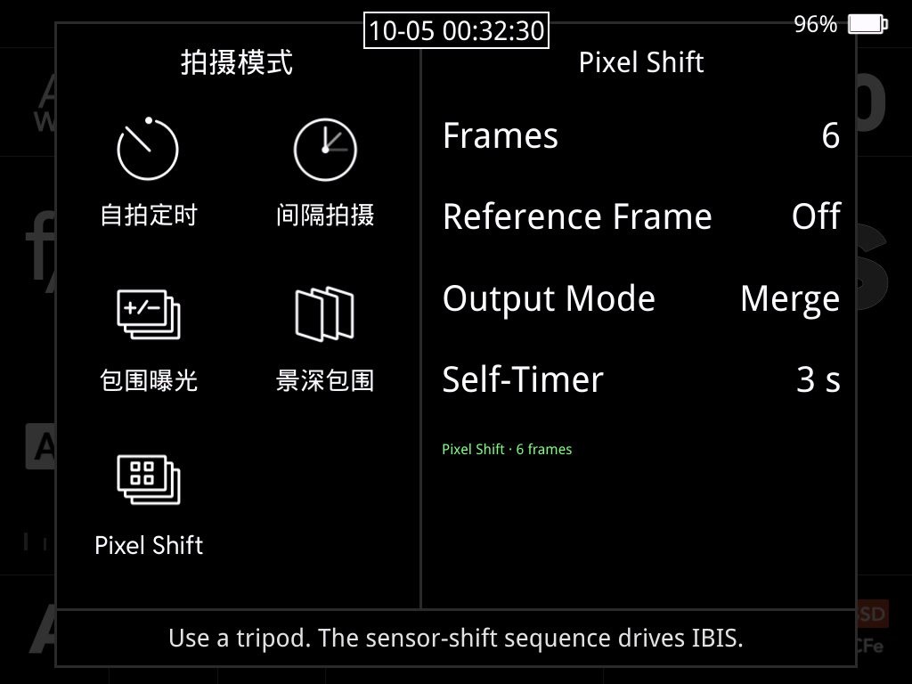
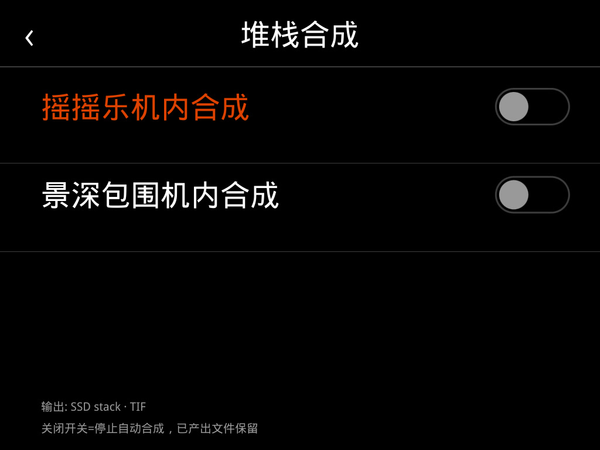
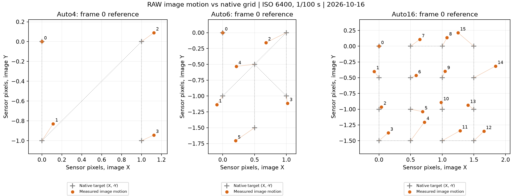
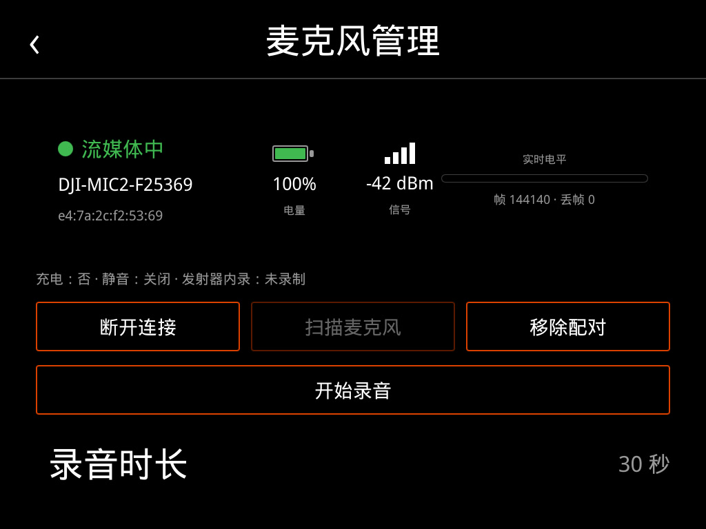
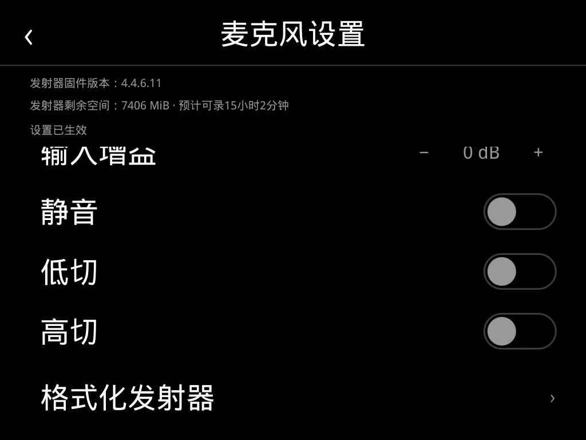

# Hasselblad X Unleashed

> A research project exploring and extending the in-camera capabilities of the Hasselblad X System.

**English** · [简体中文](README.md)

---

## 📌 Overview

This project explores the potential of Hasselblad X System camera firmware (X1D / X2D, etc.), implementing in-camera shooting and interaction features not offered by the factory — giving this precise medium-format camera a few more possibilities.

## 🚀 Progress

| Feature | Description | Status |
| --- | --- | :---: |
| Focus bracketing (depth-of-field bracketing) | Builds on the camera's existing sampling capability, automatically stepping the focus point across a burst for focus stacking in macro / product photography | ✅ Done |
| In-camera pixel shift merge | Uses sensor-shift multi-exposure and merges the high-resolution image directly on the camera body | ✅ Done |
| RAW stack merge | In-camera max / min / mean merging of multiple RAW frames | ✅ Done |
| Direct wireless printing | The camera connects to a wireless printer and outputs photos directly, with no computer or phone in between | ✅ Done |
| In-camera NES games / DOOM | Runs an NES emulator and the classic game DOOM on the camera's display, with support for playing via a bridged PS5 (DualSense) controller | ✅ Done |
| In-camera wireless microphone | Supports a pair of DJI MIC wireless microphones for stereo audio input: internal recording at 48 kHz / 24 bit, 48 kHz / 16 bit over the camera's Wi-Fi link | ✅ Done |
| External monitor (UVC) | The camera outputs its live view over USB as a standard UVC device, plug-and-play on any computer; companion Android / iOS apps add zebra, false color, focus peaking, histogram, aspect masks and other monitoring tools | ✅ Done |
| Video recording | Unlocks the camera body's video recording capability, with MP4 now produced directly in-camera | 🚧 In progress |

> More features are being explored — feedback and discussion are welcome.

## 📝 TODO

- [ ] **Combine video recording with the wireless microphone audio track** — mux the wireless mic's audio directly into in-camera video recording.
- [ ] **Possible DJI RC control support** — explore controlling the camera via a DJI RC remote.

> These features will be open-sourced once they are polished. At that point, any parts involving potentially infringing or legally questionable exploits will be removed, keeping only publicly shareable, compliant implementation ideas.

## 📂 Repository layout

| Directory | Contents |
| --- | --- |
| `hasselblad_mic/` | Wireless microphone: scanning / pairing, connection management and settings, LC3plus decoding, PCM FIFO, WAV recording, plus audio-lease interfaces for video recording |
| `hasselblad_monitor/` | External monitor (camera side): UVC gadget frame feeder and kernel-runtime guard modules |
| `hasselblad_monitor_android/` | External monitor (Android viewer): UVC capture + GL rendering with the full monitoring toolset |
| `hasselblad_x2nes/` | In-camera NES emulator and DOOM, including the native GUI menu-entry injection |
| `hasselblad_x2print/` | In-camera IPP wireless printing service (D-Bus contract, three-level printer discovery, production deployment) |

## 📸 Screenshots

### Focus bracketing / Pixel Shift shooting modes

The in-camera shooting-mode menu, with new "Focus bracketing" and "Pixel Shift" options (the sensor-shift sequence drives IBIS).

### Stack merge

Pixel Shift merge and focus-bracketing merge are completed directly in-camera, output as TIF.

### Pixel Shift: Auto4 / Auto6 / Auto16 motion patterns and merge uses

On 2026-09-28 the point sequences below were verified through the factory motion commands, axis response/readback, and image registration of 26 real captured RAWs. See the [factory multi-shot motion verification](docs/MULTISHOT_MOTION_20260928.md) for the detailed record.

| Mode | Verified factory point design | Merge use | Current product rule |
| --- | --- | --- | --- |
| Auto4 | Integer four-point shifts | Suited to ~100 MP full-color merging: R, G1, G2 and B are measured at the same scene position | Frame-by-frame saving only, for desktop merging |
| Auto6 | Two half-pixel positions added on top of the four integer points | Suited to ~400 MP merging; adds spatial sampling and still requires a reconstruction algorithm | Optional in-camera Merged or frame-by-frame Photos |
| Auto16 | 4 × 4 serpentine grid with 0.5-pixel steps | Suited to fuller full-color super-resolution reconstruction, or registration-based denoising; process it however you like on the desktop | Frame-by-frame saving only, for desktop merging |

Frame-by-frame saving follows the body's image-quality image-format setting; the reference frame is optional and is not counted among the 4 / 6 / 16 shifted frames above.
The four-frame full-color merge use case does not mean a four-frame in-camera merge is currently provided.

### Real-world comparison: Pixel Shift merge vs normal single shot

Same scene captured at ISO 6400 (B0001053 / B0001054):

| Item | 1053: Pixel Shift merged | 1054: Normal single shot |
| --- | --- | --- |
| HEIC size | 23310 × 17482 (407.51 MP) | 11656 × 8742 (101.90 MP) |
| HEIC encoding | 10-bit, 4:2:0, 8×6 tiles | 10-bit, 4:2:0, 4×3 tiles |
| RAW storage | 23310×17482, 16-bit single-channel CFA | 11904×8842, 16-bit single-channel CFA (incl. sensor border) |
| ISO / focal length | 6400 / 100 mm | 6400 / 100 mm |
| Recorded exposure / aperture | 0.00929 s / f4.74 | 0.01000 s / f4.8 |
| Capture time | 20:13:07 | 20:17:27 |
| 3FR | 819,400,704 bytes | 213,864,448 bytes |
| HEIC | 132,702,208 bytes | 56,125,440 bytes |

> For the full same-region 400% / 800% comparison see the [`reports/Pixel Shift_compare_1053_1054`](reports/Pixel%20Shift_compare_1053_1054/) directory (includes a local interactive REPORT.html).

### In-camera wireless microphone

Connects directly to wireless mics such as the DJI MIC, with live battery, signal, level and dropped-frame monitoring, plus input gain, low-cut / high-cut and mute settings.

### Direct wireless printing

The camera connects directly to a wireless printer to output photos (demo video):

🎬 [`assets/screenshots/print.mp4`](assets/screenshots/print.mp4)

### In-camera NES games / DOOM

Running an NES emulator and the classic game DOOM on the camera's display, with support for playing via a bridged PS5 (DualSense) controller (demo video):

🎬 [`assets/screenshots/nesgame.mp4`](assets/screenshots/nesgame.mp4)

## 🙏 Acknowledgements

Special thanks to **[@YuHaoyua](https://github.com/YuHaoyua)** for generously sharing the CIM firmware encryption scheme and the related keys. It is this spirit of openness that made this project possible:

👉 [hasselblad-cim-firmware-extractor](https://github.com/YuHaoyua/hasselblad-cim-firmware-extractor)

## ⚠️ Disclaimer

- To prevent anyone from profiting off an information gap, **this repository only shares workable ideas and approaches**. It does **not** cover remote command execution on the camera or any instructions for bypassing SELinux.
- This project is **for personal reference, learning, and research only**. Please do not use it for commercial purposes.
- The material is based on research using publicly available information and my own devices. If anything here is found to infringe on the legitimate rights of Hasselblad, please contact me and I will address it promptly.
