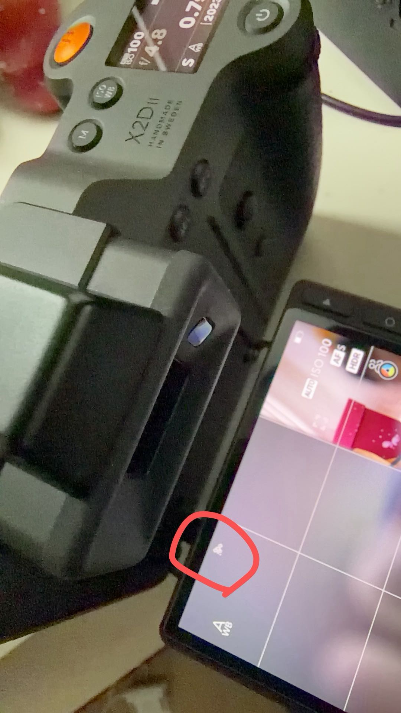
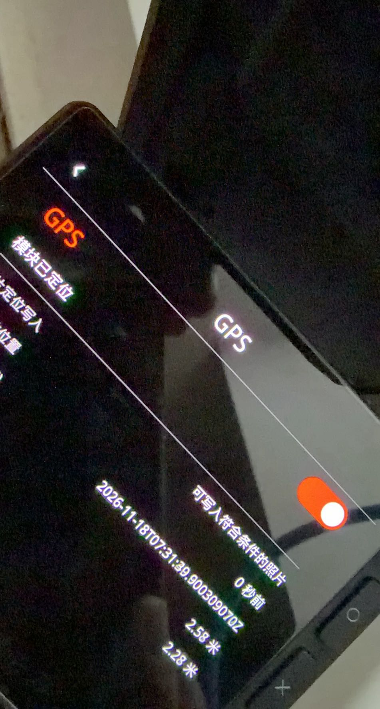
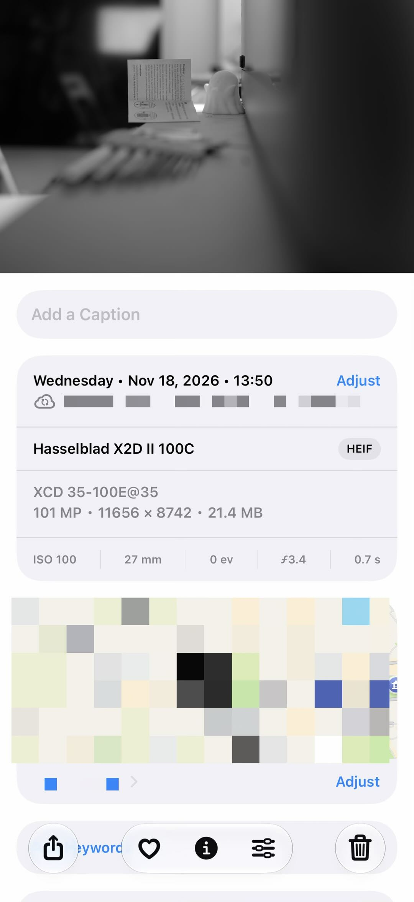

# hasselblad_gps — X2D II GPS Geotagging

**English** · [简体中文](README.md)

---

Ports the GPS lifecycle of the Hasselblad X1D / X1D II (position source → daemon →
D-Bus distribution → photo write-in) to the X2D II, a body with no GPS hardware:
a `com.hasselblad.gpsd` D-Bus service + a photo-watching pipeline + a GPS injector
covering all three file formats (3FR / JPG / HEIC) + x2print-grade persistent
deployment.

Two position sources are supported:

- **Factory X1D GPS module** — read directly as hotshoe UART NMEA;
- **DIY Bluetooth module** — an HGLRC M100 MINI GNSS receiver on an ESP32-S3 mini
  super board (or an nRF52840 Bluetooth radio module); firmware, wiring, flashing
  and acceptance checks are covered in
  [`firmware/m100_s3/README.md`](firmware/m100_s3/README.md) (Chinese).

> **Status & limitations**: the current source does not work out of the box — it
> ships without the GUI, but it does include extra coexistence logic such as
> Bluetooth contention handling, microphone pause and DIY module discovery; if
> you only want the factory-module functionality, you likewise need to implement
> it yourself with this as a reference. This repository provides implementation
> ideas only.
>
> Wiring note: the X2D II hotshoe RX is GPIO 122; for the original X2D, community
> reports say 96 / 97 (unverified) — confirm on your own hardware before wiring.

## Demonstrated results

Once a fix is acquired the live view shows a GPS indicator; newly taken photos
(3FR / JPG / HEIC) get their location written automatically, ready to view on the
map in any photo app.





## Layout

| Path | Contents |
|---|---|
| firmware/m100_s3/ | DIY Bluetooth module firmware (ESP32-S3 + HGLRC M100 MINI): NMEA / UBX parsing, BLE passthrough, PC-side capture and acceptance scripts |
| src/splus_gps/ | In-camera resident location service: Bluetooth (BSA) bridge, direct hotshoe read, source selection and microphone coexistence policy; status published on the bus as `com.hasselblad.splus.Gps` |
| src/gpsd/ | General-purpose daemon (C99 + libdbus): `com.hasselblad.gpsd /gpsd`, multi-source position input + fix / age gating |
| src/gpsctl/ | CLI client: set/get/status/enable/disable/simulate/monitor |
| inject/hginject.c | 3FR/JPG/HEIC injector (single file, zero dependencies, with --revert exact undo) |
| dbus/INTERFACE.md | D-Bus contract (full method/signal/property signatures + busctl examples) |
| dbus/REGISTRATION_AND_PERSISTENCE.md | Bus registration and autostart notes |
| deploy/ | Boot-persistence recipes: `s_hgpsd.rc` / `splus_gps.rc` (same shape as x2print's s_x2dprint, persist switches) |

## Architecture (benchmarked against the X1D II)

Two components share the work on the camera: `src/splus_gps` owns the source side
(Bluetooth BSA bridge, hotshoe read, microphone coexistence and source selection,
publishing `com.hasselblad.splus.Gps` status and the photo-write cache), while
`src/gpsd` mirrors the semantics of the X1D II factory gpsd, accepting the
position sources below and distributing them:

```
Position source                X1D II counterpart
  DBus SetPosition (primary) ←  gpsd reads the built-in u-blox UART (no HW → fed externally)
  /tmp/gps.cur file (compat) ←  gps_push.py protocol
  TCP NMEA bridge (RMC/GGA)  ←  SUC hotshoe soft-serial NMEA
  Local UART NMEA (default)  ←  same driver as the X1D II built-in GPS (ttyS3:9600)
  (/dev/ttyUSB0 @9600 8N1;     X2D II via USB host + the device's own ftdi_sio.ko:
   FTDI 3.3V board on USB-C    enumerates as ttyUSB*, hotplug tolerant, insmod
   with the X1D GPS module /   attempted up front, non-fatally)
   a TTL GNSS receiver)
        │
  gpsd: last-known cache + fix criteria + age gating (max_age_s, default 300s)
        │ DBus com.hasselblad.gpsd /gpsd
        │  signal positionChanged(a{sv}) / nmea_sentence(ay,y) (an homage to the X1D II)
        │  properties gps_available/latitude/longitude/altitude/fix_valid/...
        │  [optional] ibis_compensate=1 → com.hasselblad.camera set_gps_position
        │                                    (the X2D II's only official GPS face: IBIS compensation)
  Photo watching: /camera exposures_processing_counter + /storage
  propertiesChanged on storage_processing_counter triggers a scan;
  exFAT has no inotify → 2s fallback polling; 1.5s×2 size-stability check; done.list seed for dedup
        │
  exec hginject <photo> --lat .. --lon .. [--alt/--dop/--speed/--track/--nsat/--utc]
        │
  3FR:  append EXIF IFD + GPS IFD at the tail (19 tags, JLS untouched)
  JPG:  EXIF APP1 append-and-grow (preferred) → XMP padding insert → new XMP APP1
  HEIC: in-place injection into the Exif extent tail gap (box sizes / mdat / iloc unchanged)
  All:  --revert exact inverse (round-trip byte-identical, HGT1 trailer fingerprint prevents mis-reverts)
```

## Build & deployment

Deployment modes: `s_hgpsd.rc` (zzsh + seclabel hbl_camera_service + class core +
early-init; the `persist.zz.hgpsd` soft switch = 0 restores a pure factory state
after a reboot) and `splus_gps.rc` (late_start + `/data/hasselblad-gps/service.enabled`
gate, SHA-256 self-verification of the release package) — both follow the same
shape as x2print's s_x2dprint; switch semantics inherit the zz_boot persist
discipline of x2dnes/x2gps; you must uninstall before an OTA (any /system changes
are wiped by full packages).
