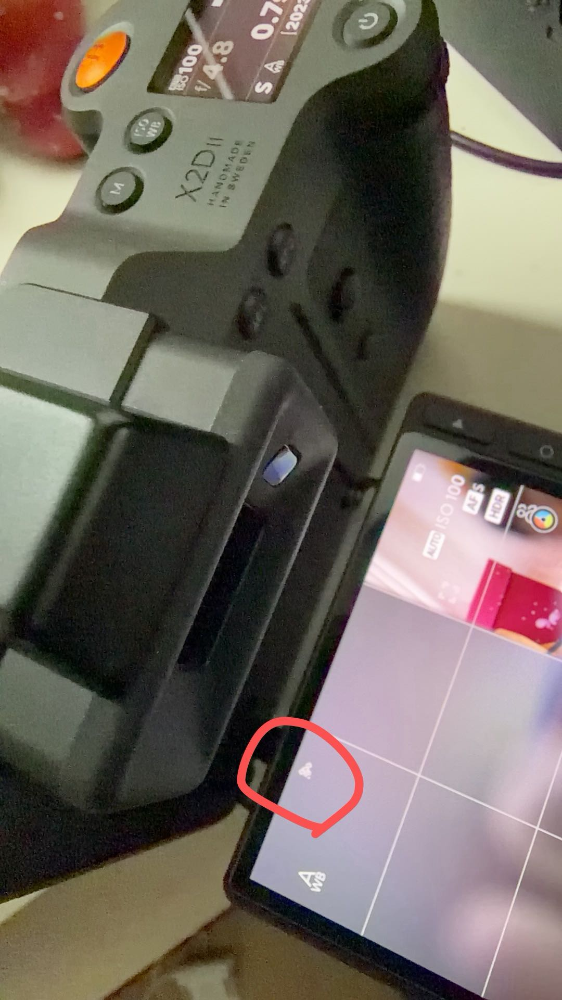
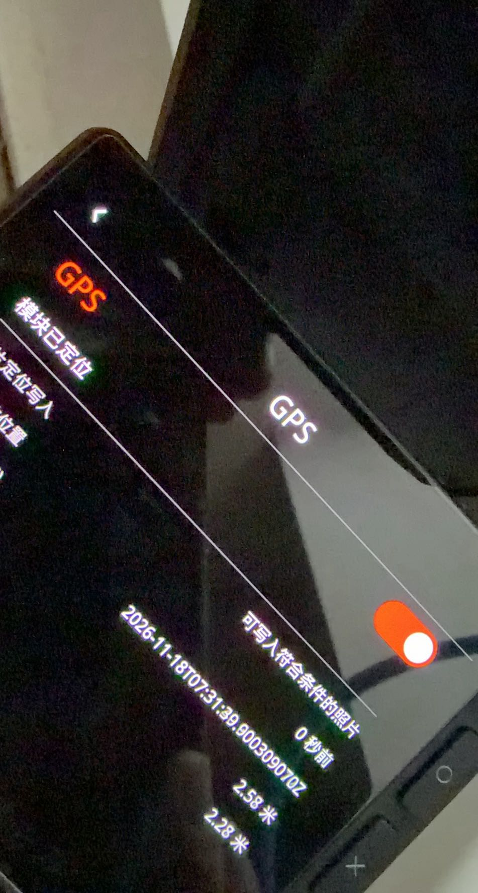
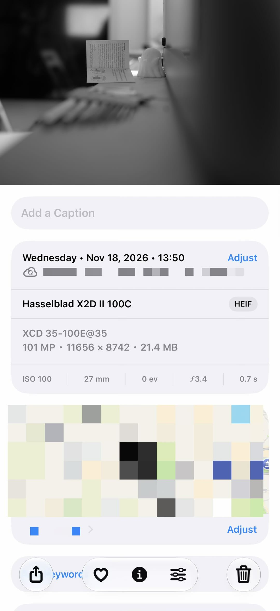

# hasselblad_gps — X2D II GPS 地理标记

[English](README.en.md) · **简体中文**

---

把哈苏 X1D / X1D II 的 GPS 生命周期(位置源 → 守护进程 → D-Bus 分发 → 照片写入)
移植到没有 GPS 硬件的 X2D II:D-Bus 服务 `com.hasselblad.gpsd` + 拍照监视管线 +
3FR/JPG/HEIC 三格式 GPS 注入器 + x2print 级持久化部署。

支持两种位置来源:

- **原厂 X1D GPS 模块** —— 热靴 UART NMEA 直读;
- **DIY 蓝牙模块** —— 化骨龙 HGLRC M100 MINI GNSS 模块 + ESP32-S3 mini super
  小板(或 nRF52840 蓝牙射频模组),固件与接线、烧录、验收见
  [`firmware/m100_s3/README.md`](firmware/m100_s3/README.md)。

> **状态与限制**:当前源码无法开箱即用 —— 未包含 GUI,但已额外实现蓝牙占用
> 处理、麦克风暂停、DIY 模块发现等协作逻辑;若只使用原厂模块功能,同样需
> 自行参考实现。此处仅提供实现思路。
>
> 接线提示:X2D II 热靴 RX 为 GPIO 122;X2D(初代)群友反馈为 96 / 97(未验证),
> 动手前请自行确认。

## 效果演示

定位成功后取景界面亮起 GPS 图标;新拍摄的照片(3FR / JPG / HEIC)自动写入
位置信息,相册 App 中即可直接查看拍摄地点。





## 目录

| 路径 | 内容 |
|---|---|
| firmware/m100_s3/ | DIY 蓝牙模块固件(ESP32-S3 + HGLRC M100 MINI):NMEA / UBX 解析、BLE 透传、PC 端采集与验收脚本 |
| src/splus_gps/ | 机内常驻定位服务:蓝牙(BSA)桥接、热靴直读、来源选择与麦克风协作策略;状态经 `com.hasselblad.splus.Gps` 上总线 |
| src/gpsd/ | 通用守护进程(C99+libdbus):`com.hasselblad.gpsd /gpsd`,多源位置输入 + fix / age 门控 |
| src/gpsctl/ | CLI 客户端:set/get/status/enable/disable/simulate/monitor |
| inject/hginject.c | 3FR/JPG/HEIC 注入器(单文件零依赖,含 --revert 精确撤销) |
| dbus/INTERFACE.md | D-Bus 契约(方法/信号/属性全签名 + busctl 示例) |
| dbus/REGISTRATION_AND_PERSISTENCE.md | 上总线与自启注册说明 |
| deploy/ | 开机常驻配方:`s_hgpsd.rc` / `splus_gps.rc`(x2print s_x2dprint 同构,persist 开关) |

## 架构(对位 X1D II)

机内由两件分工:`src/splus_gps` 负责来源侧(蓝牙 BSA 桥接、热靴直读、
麦克风协作与来源选择,发布 `com.hasselblad.splus.Gps` 状态与照片写入缓存);
`src/gpsd` 对位 X1D II 原厂 gpsd 语义,接收下列位置源并分发:

```
位置源                          X1D II 对应物
  DBus SetPosition(主通道)  ←   gpsd 读内置 u-blox UART(无硬件→外部喂)
  /tmp/gps.cur 文件(兼容)   ←   gps_push.py 协议
  TCP NMEA 桥(RMC/GGA)      ←   SUC 热靴软串口 NMEA
  本地 UART NMEA(默认开)   ←   X1D II 内置 GPS 同款驱动(ttyS3:9600)
  (/dev/ttyUSB0 @9600 8N1;   X2D II 经 USB host + 设备自带 ftdi_sio.ko
   FTDI 3.3V 小板接 USB-C,   枚举 ttyUSB*,热插拔容忍,前置 insmod
   即插 X1D GPS 模块/TTL     ftdi_sio.ko 非致命尝试)
   GNSS 接收器)
        │
  gpsd: last-known 缓存 + fix 判据 + age 门控(max_age_s,默认 300s)
        │ DBus com.hasselblad.gpsd /gpsd
        │  信号 positionChanged(a{sv}) / nmea_sentence(ay,y)(致敬 X1D II)
        │  属性 gps_available/latitude/longitude/altitude/fix_valid/...
        │  [可选] ibis_compensate=1 → com.hasselblad.camera set_gps_position
        │                                    (X2D II 官方唯一 GPS 面: IBIS 补偿)
  照片监视: /camera exposures_processing_counter + /storage
  storage_processing_counter 的 propertiesChanged 触发扫描;
  exFAT 无 inotify → 2s 兜底轮询; 1.5s×2 尺寸稳定判定; done.list 种子防重
        │
  exec hginject <photo> --lat .. --lon .. [--alt/--dop/--speed/--track/--nsat/--utc]
        │
  3FR: 尾部追加 EXIF IFD+GPS IFD(19 标签, JLS 零触碰)
  JPG: EXIF APP1 追加扩容(优先)→XMP padding 内插→XMP APP1 新建
  HEIC: Exif extent 尾隙原位注入(盒长/mdat/iloc 零变更)
  全部: --revert 精确逆操作(往返字节级一致, HGT1 trailer 指纹防误撤)
```

## 构建与部署

部署模式:`s_hgpsd.rc`(zzsh + seclabel hbl_camera_service + class core +
early-init,`persist.zz.hgpsd` 软开关 = 0 时重启即纯原厂)与 `splus_gps.rc`
(late_start + `/data/hasselblad-gps/service.enabled` 门控,发布包 SHA-256
自校验)——均与 x2print s_x2dprint 同构;开关语义沿用 x2dnes/x2gps 的
zz_boot persist 纪律;OTA 前必须 uninstall(/system 改动会被全量包冲掉)。
