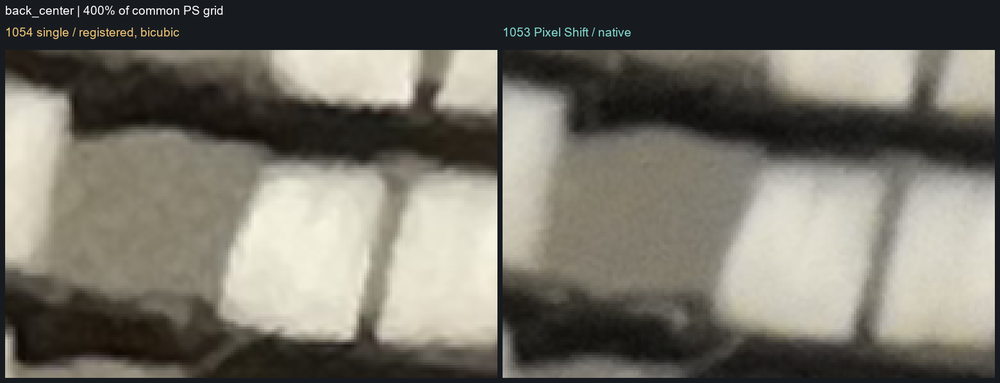
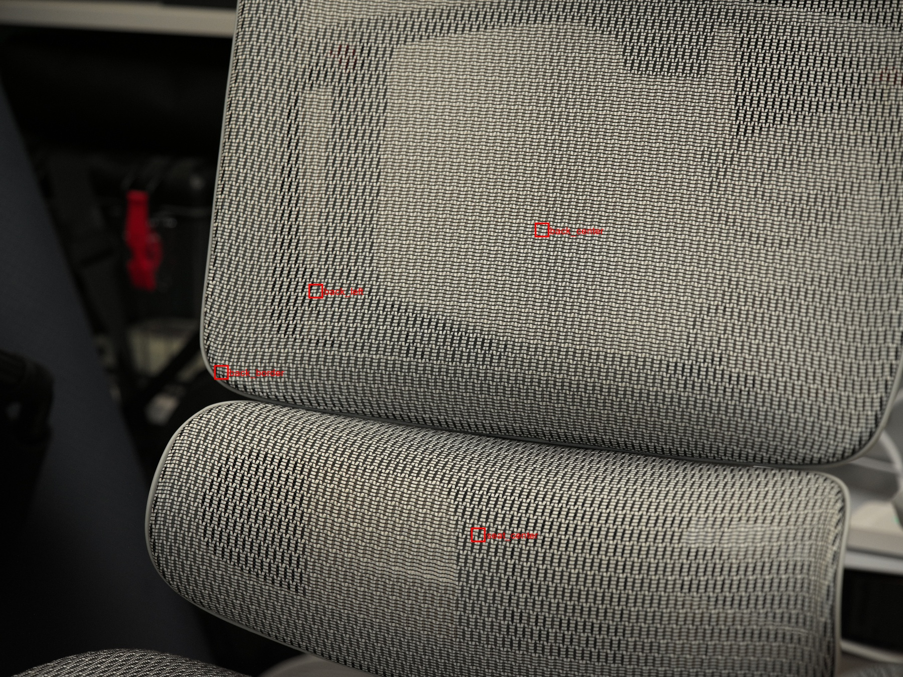

# B0001053 / B0001054 同尺寸细节比较

2026-10-16 · 已下载两张照片的 3FR 和 HEIC · 四文件 SHA-256 与相机一致（见 `camera-sha256.txt` / `local-sha256.txt`）· 原文件未修改 · 原始 3FR / HEIC / 中间数据不随仓库分发，仅保留压缩后的比较图像

> **结论：1053 的输出像素数约为 1054 的四倍，但这组样本没有显示出明确的真实细节增益。**
> 同区域观察，1053 的颗粒更细、边缘更平滑，部分织物边界更柔；没有看到稳定新增、可辨的细纤维。RAW 绿色通道采用相同处理后，也没有显示出明确优势。因此不能把本组结果称为「已验证四亿像素解析力」，也不能仅凭两张成片认定传感器没有位移。

## 原文件

| 项目 | 1053：Pixel Shift 合成 | 1054：普通单张 |
| --- | --- | --- |
| HEIC 尺寸 | 23310 × 17482（407.51 MP） | 11656 × 8742（101.90 MP） |
| HEIC 编码 | 10 位，4:2:0，8×6 瓦片 | 10 位，4:2:0，4×3 瓦片 |
| RAW 存储 | 23310×17482，16 位单通道 CFA | 11904×8842，16 位单通道 CFA（含传感器边界） |
| ISO / 镜头焦距 | 6400 / 100 mm | 6400 / 100 mm |
| 记录的曝光时间 / 光圈 | 0.00929 s / f4.74 | 0.01000 s / f4.8 |
| 拍摄时间 | 20:13:07 | 20:17:27 |
| 3FR | 819,400,704 字节 | 213,864,448 字节 |
| HEIC | 132,702,208 字节 | 56,125,440 字节 |

## 400% / 800% 比较

**左：1054 普通单张；右：1053 Pixel Shift。** 先将两者配准到 1053 的同一坐标和画面范围，再同时放大。1054 只做一次双三次重采样；400% / 800% 显示均使用最近邻，不额外锐化。此处百分比以统一后的四亿像素网格为基准，800% 图没有比 400% 图新增内容。

示例：靠背中央 400%（左单张、右像素偏移）：

四个分析区域的位置：

全部比较图（HEIC 成片与 RAW 绿色通道两套）：

| 区域 | 400% | 800% | 100% 周边 |
| --- | --- | --- | --- |
| 靠背中央 | [HEIC](back_center_400pct.png) · [RAW](back_center_raw_400pct.png) | [HEIC](back_center_800pct.png) · [RAW](back_center_raw_800pct.png) | [HEIC](back_center_context.png) · [RAW](back_center_raw_context.png) |
| 靠背左侧 | [HEIC](back_left_400pct.png) · [RAW](back_left_raw_400pct.png) | [HEIC](back_left_800pct.png) · [RAW](back_left_raw_800pct.png) | [HEIC](back_left_context.png) · [RAW](back_left_raw_context.png) |
| 座垫中央 | [HEIC](seat_center_400pct.png) · [RAW](seat_center_raw_400pct.png) | [HEIC](seat_center_800pct.png) · [RAW](seat_center_raw_800pct.png) | [HEIC](seat_center_context.png) · [RAW](seat_center_raw_context.png) |
| 靠背边缘 | [HEIC](back_border_400pct.png) · [RAW](back_border_raw_400pct.png) | [HEIC](back_border_800pct.png) · [RAW](back_border_raw_800pct.png) | [HEIC](back_border_context.png) · [RAW](back_border_raw_context.png) |

直接打开 PNG 时请选择查看器的 100%，避免二次缩放。

## 配准与观察

- HEIC：4330 个 RANSAC 内点，整体比例约 1.999933，残差中位数约 0.448 个四亿图像素；四个区域再做小于 1 像素的平移修正，没有局部拉伸、锐化或生成细节。
- HEIC 四区灰度相关系数约 0.9935–0.9949。高相关只说明相同纹理已对齐，不是解析力或位移成功率指标。
- RAW：独立配准 3658 个内点，残差中位数约 0.363 个四亿图像素。仅比较绿色通道：按各自 CFA 相位读取绿色采样，减去 LibRaw 识别的黑电平，在缺失位置做相同双线性绿色重建，统一线性范围与 γ=1/2.2。不应用白平衡、色彩矩阵、锐化或降噪。这是细节诊断，不是完整 RAW 显影。
- HEIC 比较使用同一库将 10 位解码到 8 位 RGB 展示；RAW 从 16 位采样计算，再以相同曲线显示为 8 位 PNG。不是码值精度测试。
- 在选取区域里，1053 的 HEIC 平均亮度比 1054 低约 5–6%；展示保留此差异，没有逐图拉伸对比度。曝光时间及显影参数有差异，不能把亮暗差当作细节提升。

## 这组比较能确认什么

可以确认文件输出尺寸、同场景的实际观感，以及移除后期锐化/白平衡差异后 RAW 绿色细节的表现。不能据此确定传感器步进幅度、六帧是否正确落到预设相位、镜头实际解析极限，或给出有效像素数、MTF、解析力提升倍数。ISO 6400、织物深度变化、两次拍摄对焦/微动以及不同的前处理也会影响结果。

若继续定位，应检查这次六帧的真实相对位移、帧序与 CFA 落点及合成前后的边缘；最终两张文件不足以把问题唯一归因到电机、合成或显影。

## 交互式查看器

本目录的 [`REPORT.html`](REPORT.html) 是同内容的本地交互版（区域 / 输入 / 放大下拉切换、适应页面开关）。GitHub 不渲染 HTML 文件，请下载整个目录后用浏览器打开。
